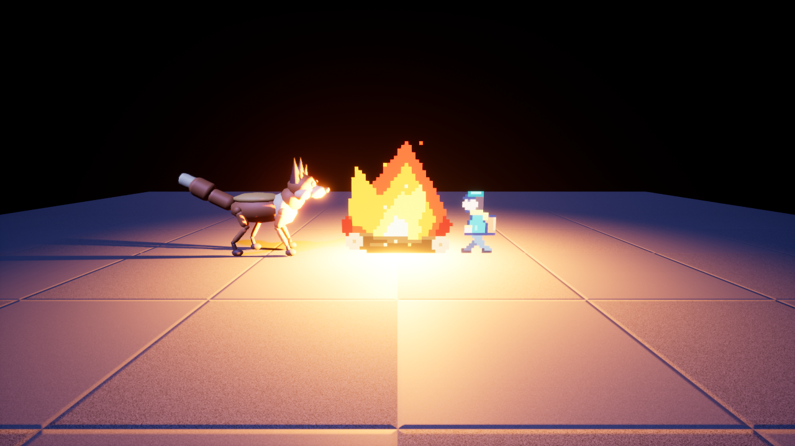
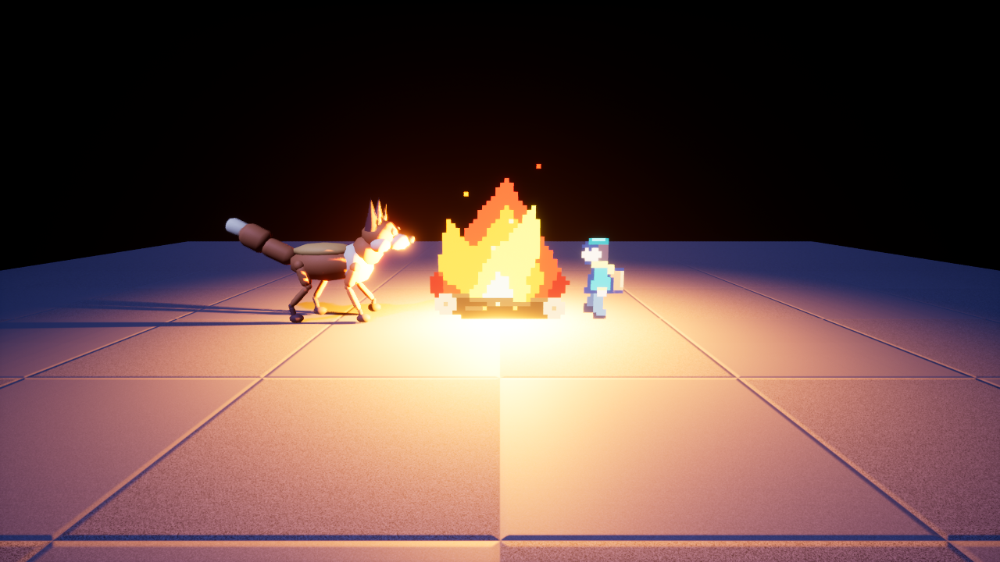

# Unreal sample scene

The Unreal and UEFN builds of the cross-engine [sample scene](https://github.com/ehartye/agent-engine/blob/main/docs/sample-scene.md).
That spec stays in agent-engine because the Godot, Unity and web builds use it too. It defines the assets (a fox GLB, a
pixel courier, a pixel campfire, a music bed and a one-shot), the scene (a clearing at dusk with a fixed camera) and the
checks, strongest first: import, clean run, screenshot, audio state. This page records what Unreal and UEFN passed. The runs below were observed on earlier engine builds and were not repeated on the pinned builds.

The build and run scripts are in [`examples/unreal`](../examples/unreal/README.md): `build_scene.py` creates the assets and the
level headless, and `run_scene.py` plays it offscreen, samples state and saves a screenshot. The importer they call is the
`unreal-import` skill.

## Status

| Engine build | Observed | Not observed |
|---|---|---|
| An earlier Unreal 5.7 build | Checks 1 and 2 for all assets: one SkeletalMesh, one Skeleton, 2 animations and 48 material instances for the fox, no errors. Check 3 by eye (screenshot above). Check 4 partly: the music bed reports playing, the campfire flipbook advances through its 8 frames at 10 fps, the fox animation plays, and the log has no errors. | Audio by ear; the pickup's variant picking (only variant 0 is placed, not playing); the courier flipbook's advance (samples landed on the same frame). |
| An earlier Unreal 5.8 build | Checks 1 and 2 for all assets after three fixes (the fox split into 48 meshes, automated imports were not saved, FBX clips needed frame-aligned lengths; the Unreal import notes in the `unreal-import` skill list them). Check 3 by eye ([screenshot](images/unreal-5.8-sample-scene.png)). Check 4 partly: the music bed reports playing, both flipbooks advance, the fox animation plays and advances. Epic's MCP server also started headless and imported textures and an FBX. | Audio by ear, pickup variant picking, any automated pixel check. |
| An earlier UEFN build | Epic's MCP server on a set port; texture import; the fox as a skeletal mesh from a converted FBX. | A scene, a play-test session, the fox's clips after the frame-rate fix, audio import (no MCP route), the memory budget. |

## Open

- A trigger and real variant picking for the one-shot.
- An automated screenshot check (pixel presence, not exact match).
- A UEFN build of the same scene; the `uefn` skill holds the routes that exist.
